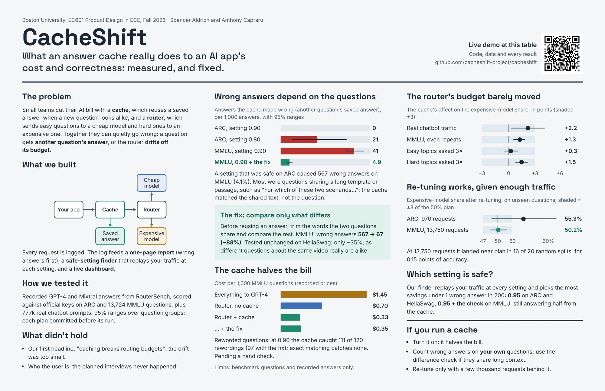

# Poster presentation (4 Dec 2026)

- **Editable poster:** a Claude design canvas, "CacheShift poster (4 Dec)" (Anthony's account; share it to edit together). Export a print PDF from its page. It is laid out on Tabloid landscape (17 × 11 in) and scales cleanly to any poster size of the same shape (e.g. 36 × 24 in, close in shape). Tell us the official size and it can be re-laid out.
- **Source:** `CacheShift_Poster.dc.html` (the canvas's artboard, for reference; the QR code points to this repository).
- **Every number on it** comes from [Sprint 4 results](../sprints/Sprint_4/Sprint4_Experiment_Results.md), [Sprint 3](../sprints/Sprint_3/README.md) or [Sprint 2](../sprints/Sprint_2/README.md).

## At the table
- Live demo: `python -m cacheshift.dashboard --dataset data/mmlu_all_20261127/questions.jsonl` (see the README). Suggested order: 0.90 on Fast until a "moral scenarios" question gets another one's answer; pause; turn on **Difference check**; run to the same point; show **Runs compared**.
- Backup: a 72-second screen recording of exactly that run (shared separately; not committed, 12 MB).

## Outline it follows
- Problem and user · What we built (architecture) · What we validated (results with ranges) · What didn't hold · What to do if you run a cache · Limits and next steps.
